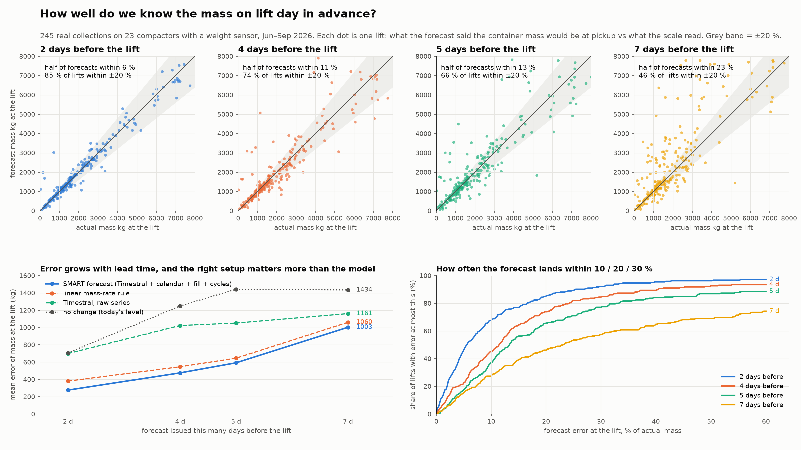
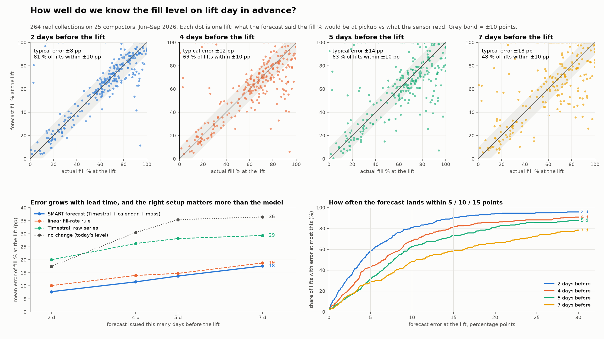

# fill-forecast — fill % forecasting backtest for Europress SMART telemetry

First experiment: take 30 days of hourly `fill_pct` for a device from the Tiger Cloud
(TimescaleDB) copy of `telemetry_hourly`, forecast the next 15 days with two time-series
foundation models, and score the forecast against what actually happened.

Models (both run locally on CPU, weights come from the Hugging Face cache):

| name | checkpoint | quantiles | licence |
|---|---|---|---|
| `timestral` | `mistralai/Timestral` (209M) | 21 (0.01 … 0.99) | Modified MIT, production OK |
| `timesfm3` | `google/timesfm-3.0-pytorch` | 9 (0.1 … 0.9) | **non-commercial**, benchmark only |
| `persistence` | last value held flat | point | baseline |
| `ramp` | mean hourly fill rate of the context (lifts excluded), extrapolated | point | baseline |

All data is the organisers' **synthetic** challenge pack (v1.0.1); none of the numbers below are
real savings, prices or device performance.

### Headline figures

Forecast issued 2 or 4 days before a collection vs. what the sensor read on the lift day:





Tables: [`outputs/showcase_mass/mass_at_lift_table.md`](outputs/showcase_mass/mass_at_lift_table.md),
[`outputs/showcase/fill_at_lift_table.md`](outputs/showcase/fill_at_lift_table.md). The rest of
`outputs/` is git-ignored and regenerated by the commands below.

## Setup

```bash
cd forecast
uv sync --python 3.14
cp .env.example .env          # or: printf 'DATABASE_URL=%s\n' "$(tiger db uri <service-id> --with-password)" > .env
```

`.env` holds the database password and is git-ignored; never commit it. The site calendar for
the `public` schema is read from the challenge parquet files: unzip the organisers' pack next to
this folder (`../Europress_SinceAI2026_FINAL/...`) or point `CHALLENGE_DATA_DIR` at its
`data/competition/public` directory.

## Run

```bash
# one device, explicit forecast origin (UTC)
uv run python backtest.py --device CMP-00013 --cutoff 2026-08-16

# several devices in one batched call per model, default cutoff = latest data − 15 days
uv run python backtest.py --devices CMP-00013,CMP-00007,CMP-00001,CMP-00006,CMP-00011 --cutoff 2026-09-01

# smoke test without model weights
uv run python backtest.py --device CMP-00013 --models persistence,ramp
```

Options: `--context-days 30 --horizon-days 15 --resolution 1` (hours), `--schema public|europress`,
`--as-of` (hide rows received after the cutoff), `--known-covariates` (hour-of-week features),
`--timestral-repo mistralai/Timestral-123M`, `--device-type cpu|mps`.

Per device run it writes `outputs/<device>_<cutoff>/` with `forecast.csv` (actual + q10/q50/q90
per model), `metrics.csv`, `run.json`, `plot.png`, and one `outputs/summary_<stamp>.csv` per call.

## Database layout (Tiger Cloud TimescaleDB)

- `public.*`: the 25-device CSV sample, one year 2025-10 → 2026-09. Backtests run here.
- `europress.*`: Torsti's live simulated feed (50 devices, started at sim date 2026-10-23, 30× speed).
  Only ~15 simulated days existed on 2026-11-07, so it cannot yet feed a 30+15 day backtest.
  Use `--schema europress` once it has 45+ days.
- `telemetry_hourly` is a raw ingest log: the loader de-duplicates on `message_id`
  (earliest `received_at`) and gap-fills to a regular hourly grid; gaps stay NaN and go to the
  models as a mask (TimesFM gets them linearly interpolated).

## Metrics

Per lead bucket (`d1_3` = hours 1–72, `d4_7`, `d8_15`, `all`): MAE, RMSE, bias (forecast − actual),
CRPS (≈ 2 × mean pinball over all quantiles), `coverage_80` / `width_80` of the q10–q90 band, and
skill = 1 − MAE/MAE_baseline against persistence and ramp. No MAPE: fill sits near 0 after a lift.
For ON_CALL devices the `all` row also has `hours_to_threshold_*`: lead time at which the actual,
the forecast median and the forecast q90 first reach the device's `on_call_threshold_pct`.

## Results, 5 devices × 2 cutoffs (2026-08-01, 2026-09-01), hourly, 720 h context → 360 h horizon

Mean MAE in fill percentage points:

| model | d1_3 | d4_7 | d8_15 | all | coverage_80 (all) |
|---|---|---|---|---|---|
| timestral | **8.1** | **26.4** | **17.2** | **17.8** | 0.78 |
| timesfm3 | 9.1 | 26.5 | 19.3 | 19.2 | 0.74 |
| persistence | 13.8 | 30.7 | 22.7 | 23.0 | – |
| ramp | 8.3 | 33.1 | 37.6 | 30.6 | – |

MAE (all) per device and cutoff:

| device | policy | cutoff | timestral | timesfm3 | persistence | ramp |
|---|---|---|---|---|---|---|
| CMP-00001 | ON_CALL 79 % | 08-01 | 21.7 | 21.6 | 23.5 | **19.6** |
| | | 09-01 | 23.7 | **14.2** | 31.0 | 27.0 |
| CMP-00006 | HYBRID | 08-01 | 21.0 | 20.9 | 20.5 | **18.7** |
| | | 09-01 | **8.7** | 17.7 | 22.0 | 52.5 |
| CMP-00007 | ON_CALL 68 % | 08-01 | 12.9 | 12.8 | 13.0 | **11.1** |
| | | 09-01 | **15.0** | 20.3 | 14.3 | 33.8 |
| CMP-00011 | FIXED Thu | 08-01 | 15.1 | **15.0** | 21.8 | 16.4 |
| | | 09-01 | **14.6** | 22.0 | 20.6 | 54.3 |
| CMP-00013 | ON_CALL 61 % | 08-01 | 21.3 | **21.1** | 23.6 | 21.2 |
| | | 09-01 | **24.0** | 26.0 | 39.9 | 50.9 |

Inference time: ~0.1 s (Timestral) and ~0.2 s (TimesFM 3.0) for 5 devices on an M5 Pro CPU, so
running all 447 devices hourly is trivial.

### What the plots show

- Both models track the **fill ramp** for the first 2–3 days about as well as the simple ramp
  baseline, and beat persistence everywhere.
- The hard part is the **lift timing**. Over 15 days the median forecast hedges: it averages
  over "lift happens / doesn't happen" and flattens out at 20–40 %, which is why `d4_7` is the
  worst bucket for everyone. Where the schedule is regular (CMP-00011, fixed Thursday lifts;
  CMP-00006 hybrid) Timestral reproduces the weekly sawtooth, including the drops, and wins clearly.
- Because the median hedges, **it almost never crosses the on-call threshold**, even when the
  actual does within 2–6 days. The q90 band does cross, mostly a day or two early
  (e.g. CMP-00013 at the 09-01 cutoff: actual 40 h, Timestral q90 68 h, TimesFM q90 65 h;
  CMP-00001: actual 155 h, q90 97/120 h). The ramp baseline is a fair "if nothing is collected"
  estimate for the first week but blows up after that.
- The 80 % band covers 74–78 % of actuals overall; it is too narrow in days 4–7 (59 %) and
  too wide in days 8–15, again the lift-timing uncertainty.

### Recommendation

The foundation models are a usable **zero-shot** fill forecaster with calibrated-ish bands and no
training, and Timestral is the one to keep (licence + accuracy). For the business question
"when will this container need a lift", do not read the median; use the **q75/q90 crossing of
the threshold** as a "could be full by" time, or forecast the next lift as a separate event and
let the model forecast the fill ramp up to it. Known-future covariates (site opening calendar,
weekday) are available through `--known-covariates` and are the next thing to test, together
with longer context (60 d) and the 3-hour resolution.

### Next step: forecast table

If the team wants these in the database, a hypertable like

```sql
CREATE TABLE fill_forecast (
  device_id   text        NOT NULL,
  issued_at   timestamptz NOT NULL,   -- forecast origin (cutoff)
  target_time timestamptz NOT NULL,
  lead_hours  smallint    NOT NULL,
  model       text        NOT NULL,   -- 'timestral:Timestral' etc.
  q10 real, q50 real, q90 real,
  PRIMARY KEY (device_id, issued_at, target_time, model)
);
SELECT create_hypertable('fill_forecast', 'issued_at');
```

plus `fill_forecast_run (issued_at, model, revision, context_hours, horizon_hours, seconds)` is
enough; `forecast.csv` already has exactly these columns.

## Lift-anchored backtest: how well is the fill level before a lift predicted x days earlier?

`lift_backtest.py` takes every COMPLETED/PARTIAL collection event (264 lifts on all 25 `public`
devices, 2026-06-01 → 2026-09-30), issues a forecast at 2, 4, 5 and 7 days before the lift hour
with 30 days of context, and compares the forecast for the last hour before the lift with what
the device actually read then (mean actual fill before a lift: 64 %).

```bash
uv run python lift_backtest.py --models timestral,timesfm3,timestral_cum,timesfm3_cum --out outputs/lift_backtest_cum
```

Outputs: `per_event.csv` (one row per lift × lead × model), `summary.csv`, `summary_threshold.csv`,
`summary.png` (predicted vs actual fill at lift, one panel per lead) and three example plots that
show the four forecasts converging on one lift.

Two extra variants, `timestral_cum` and `timesfm3_cum` (`fill_forecast.models.Cumulative`), feed
the model the fill series **with lifts undone** (a monotone cumulative-inflow series), forecast
the inflow, and add it to the current fill level. The model then only has to forecast "how much
comes in", not "when will someone empty it".

MAE of the fill level just before the lift, fill percentage points, all 264 lifts:

| forecast issued … before lift | 2 d | 4 d | 5 d | 7 d |
|---|---|---|---|---|
| timestral (raw) | 20.0 | 26.3 | 28.1 | 29.3 |
| timesfm3 (raw) | 14.7 | 22.1 | 23.6 | 24.4 |
| **timestral_cum** | **9.0** | **13.2** | 15.0 | 18.8 |
| timesfm3_cum | 9.2 | 13.3 | 15.2 | 19.6 |
| persistence | 17.5 | 30.5 | 35.4 | 36.4 |
| ramp | 10.1 | 14.0 | **14.8** | **18.8** |

Bias of the same (forecast − actual): raw models −10 to −26 (they hedge toward "a lift might
happen"); `*_cum` −1 to −3 at 2–5 d and +2 to +4 at 7 d; ramp −1 to +5.
80 % band coverage at the lift hour: `timestral_cum` 0.68 / 0.69 / 0.68 / 0.55 for 2/4/5/7 d
(`timesfm3_cum` 0.65 / 0.58 / 0.54 / 0.42; the raw models sit at 0.64–0.71 but around a biased median).
Restricting to windows with no other lift in between (258/248/240/189 lifts) gives the same
picture: `timestral_cum` 7.9 / 11.0 / 12.2 / 13.9 vs ramp 9.0 / 11.9 / 11.9 / 13.5.

ON_CALL devices (166 lifts): the device actually reached its on-call threshold before the lift
in 77–79 % of cases. The raw medians reach it in 17–39 %, `*_cum` medians in ~50 %, the q90 in
~70 % with the crossing typically 5 h (2 d lead) to 25 h (7 d lead) too early.

**Reading:** two days out, the fill level at the lift is predicted to within about 9 points
and the error grows to about 19 points at a week. The transform matters more than the model:
raw foundation-model medians underpredict by 10–26 points because they average over possible
lifts, while the cumulative variants are unbiased and match or beat the mean-rate ramp baseline
with the bonus of calibrated-ish uncertainty bands. Timestral and TimesFM 3.0 are within a point
of each other; Timestral's bands are better calibrated and its licence allows production use.

## Extra inputs: which ones help? (`covariate_test.py`, leads 2 and 4 days)

Same lift-anchored protocol (264 lifts), base model `timestral_cum`. Experiments are written
`model[@context_days][+feature...]`:

| feature | kind | source |
|---|---|---|
| `how` | known future | hour-of-week sin/cos + weekend flag (local time) |
| `cal` | known future | site calendar: open-this-hour and open-this-day flags, from `data/competition/public/reference/site_calendar.parquet` (not loaded into the DB for the `public` devices; `europress.site_calendar` exists for the feed) |
| `cycles` | past only | compaction cycles per hour from `telemetry_hourly` |
| `mass` | past only | `mass_kg` (VALID readings) with lifts undone, i.e. cumulative collected mass |
| `@60` | – | 60 days of context instead of 30 |

```bash
uv run python covariate_test.py --leads 2,4                       # single additions
uv run python covariate_test.py --leads 2,4 --out outputs/covariate_test_combo \
  --experiments "timestral_cum,timestral_cum+mass,timestral_cum+cal+mass,timestral_cum@60+cal+mass,timestral_cum@60+cal+mass+cycles"
```

MAE of the fill level just before the lift (all 264 lifts; coverage of the 80 % band in brackets):

| experiment | 2 d | 4 d |
|---|---|---|
| timestral_cum (reference) | 8.99 (0.68) | 13.15 (0.69) |
| +how | 8.71 (0.71) | 12.96 (0.72) |
| +cal | 8.53 (0.70) | 13.00 (0.69) |
| +cycles | 8.58 (0.68) | 12.90 (0.68) |
| +mass | 8.25 (0.72) | 12.55 (0.71) |
| @60 | 8.77 (0.70) | 12.90 (0.70) |
| @60+cal | 8.43 (0.71) | 12.29 (0.71) |
| +cal+mass | 7.90 (0.73) | 12.28 (0.72) |
| @60+cal+mass | 7.93 (0.75) | 11.56 (0.75) |
| **@60+cal+mass+cycles** | **7.75 (0.75)** | **11.52 (0.78)** |
| @60+cal+how+mass | 8.19 (0.72) | 12.36 (0.73) |
| timesfm3_cum | 9.20 (0.65) | 13.26 (0.58) |
| timesfm3_cum+cal+how | 8.93 (0.70) | 13.58 (0.58) |
| ramp | 10.08 | 13.99 |

Paired per-lift comparison against the reference: the best combination lowers the absolute
error by 1.2 points at 2 d and 1.6 points at 4 d on average and improves 54–57 % of lifts; its
bias is ≈ 0 (reference −1.4 / −2.5). On windows without another lift in between the best
combination reaches 6.7 (2 d) and 9.1 (4 d) points.

**Reading:**
- Every extra input helps a bit; none is dramatic on its own (0.2–0.8 points on a 9–13 point error).
- **Mass** is the most useful single input: a second, independently-noisy view of the same
  inflow. The lift-undone cumulative mass is what makes it usable.
- **Site calendar** is worth more than generic hour-of-week features, and hour-of-week on top of
  the calendar slightly hurts, so drop `how` when `cal` is available. The calendar is also a
  known-future input, so it is the one that can tell the model about an upcoming holiday closure.
- **60-day context** helps mainly at 4 days and mostly in combination with the calendar.
- TimesFM 3.0 does not benefit from the calendar at 4 days, and its bands are too narrow (58 %
  coverage), so Timestral remains the choice.
- Recommended production configuration: `timestral_cum@60+cal+mass+cycles`, i.e. Timestral on
  the lift-undone fill series with 60 days of context, the site calendar as known covariate,
  and cumulative mass plus compaction cycles as past covariates. Runtime is ~0.1 s per forecast
  on CPU. The forecast table should therefore store, besides q10/q50/q90, the config name and
  model revision used.

## Mass before the lift (`covariate_test.py --target mass_kg`)

Same lift-anchored protocol on the weight-sensor series `mass_kg` (VALID readings only, 23 of the
25 devices have a scale; 239–245 lifts per lead). Lifts in the context are detected as drops larger
than 30 % of the series' 95th percentile, since containers range from ~1 000 to ~8 000 kg. The
forecast is scored against the scale reading in the last hour before the lift and, where a
ticket exists (≈ 185 lifts), against the weighbridge net mass of that collection.

```bash
uv run python covariate_test.py --target mass_kg --leads 2,4,5,7 --out outputs/showcase_mass \
  --experiments "timestral_cum,timestral_cum+cal,timestral_cum+fill,timestral_cum+cycles,timestral_cum@60+cal+fill+cycles,timestral_cum@60+cal+fill,timestral,ramp,persistence"
uv run python showcase.py outputs/showcase_mass mass_kg
```

Best configuration `timestral_cum@60+cal+fill+cycles` (60 d context, site calendar, lift-undone
fill % and compaction cycles as past covariates); the `@60+cal+fill` variant is marginally better
at 5–7 days.

| forecast issued | MAE kg | half of forecasts within | within 10 % | within 20 % | 80 % band hit rate | vs weighbridge, half within |
|---|---|---|---|---|---|---|
| 2 days before lift | 276 | 5.5 % | 68 % | 85 % | 76 % | 9 % |
| 4 days before lift | 476 | 11.5 % | 45 % | 74 % | 81 % | 14 % |
| 5 days before lift | 592 | 13 % | 37 % | 66 % | 75 % | 18 % |
| 7 days before lift | 1003 | 23 % | 27 % | 46 % | 65 % | 26 % |

References at 2 / 4 / 7 days, MAE kg: plain cumulative Timestral 316 / 523 / 1009, ramp rule
380 / 547 / 1060, raw Timestral 699 / 1023 / 1161, persistence 706 / 1250 / 1434.

**Reading:**
- Mass behaves like fill: the cumulative transform is essential (raw model error is 2–3× larger),
  and compaction cycles plus the calendar are the useful extras; adding the fill series itself
  brings almost nothing because it carries the same information as the mass series.
- Two days ahead the mass at pickup is known to about ±6 % for half the lifts and within 20 % for
  85 % of them; a week ahead the error is about a quarter of the load, and the forecast is biased
  high because many 7-day windows contain another lift.
- The scale itself agrees with the weighbridge to ~3 % (median), so the forecast error against the
  weighbridge ticket is mostly forecast error, not sensor error. Equal-split allocations of
  combined loads add noise on the weighbridge side.
- Mass is harder than fill in relative terms at long leads (23 % vs ~18 pp on a ~64 % mean fill)
  because mass keeps rising after the container is "full" by volume while compaction continues.

## Forecast table and job (`forecast_job.py`, `fill_forecast/schema.sql`)

Scope agreed on 2026-11-07: **mass only, horizon 2–4 days**. The job writes hourly quantiles for
the next 96 h so that both the 2-day and the 4-day values are available.

Tables (created per schema with `CREATE … IF NOT EXISTS`; nothing existing is touched):

| object | purpose |
|---|---|
| `<schema>.mass_forecast` | hypertable on `issued_at`; one row per `device_id, model, issued_at, target_time` with `lead_hours`, `mass_kg_q10/q50/q90`, `mass_kg_at_issue`, `run_id` |
| `<schema>.mass_forecast_run` | one row per job run: model spec, model revision, context/horizon hours, device count, seconds, notes |
| `<schema>.mass_forecast_latest` | view: the newest issue per device and model (96 rows per device) |

Conventions: `issued_at` is the end of the last complete telemetry hour used as context;
`target_time = issued_at + lead_hours` and is the end of the forecast hour, matching `measured_at`.
Rows are upserted, so re-running an issue time overwrites it. `model` holds the experiment spec
(`timestral_cum@60+cal+fill+cycles` by default) so several models can coexist in the table.

```bash
uv run python forecast_job.py --schema europress                 # issue at the end of the last complete hour of the feed
uv run python forecast_job.py --schema europress --dry-run       # print only
uv run python forecast_job.py --schema public --backfill-from 2026-08-01T05:00Z --backfill-to 2026-09-26T05:00Z --every-hours 24
```

What is in the database now:
- `europress.mass_forecast`: one issue at simulated 2026-11-07 05:00 (the feed's last hour; Torsti's
  uploader had stopped), 47 of 49 scale-equipped devices, 15 days of context (the job uses whatever
  history exists, minimum 7 days), 4 512 rows. CMP-00033 is skipped (sensor FAULT, no valid mass).
- `public.mass_forecast`: daily issues at 05:00 UTC from 2026-08-01 to 2026-09-26, 23 devices,
  121 344 rows, for forecast-versus-actual demos.

Sanity check of the backfill against the telemetry, all target hours (SQL in this section's
history, join on `target_time` = telemetry hour end):

| lead | n | MAE kg | median relative error | 80 % band hit rate |
|---|---|---|---|---|
| 24 h | 1 240 | 306 | 7 % | 65 % |
| 48 h | 1 235 | 562 | 12 % | 66 % |
| 72 h | 1 231 | 816 | 19 % | 63 % |
| 96 h | 1 228 | 1 044 | 29 % | 53 % |

These are worse than the lift-day numbers in the previous section because they include target
hours *after* a lift happened inside the horizon: the forecast is the "no collection in between"
scenario by design (it forecasts inflow). Consumers should read it as "mass if not emptied before
`target_time`", and use the lift-day evaluation (2 d: ±6 %, 4 d: ±11 % for half the lifts) as the
accuracy to quote.

Useful queries:

```sql
-- expected mass in 2 and 4 days for every device, newest forecast
SELECT device_id, lead_hours, target_time, mass_kg_at_issue, mass_kg_q10, mass_kg_q50, mass_kg_q90
FROM europress.mass_forecast_latest WHERE lead_hours IN (48, 96) ORDER BY device_id, lead_hours;

-- forecast vs actual for one device (public backfill)
SELECT f.issued_at, f.lead_hours, f.mass_kg_q50, avg(t.mass_kg) AS actual
FROM public.mass_forecast f
JOIN public.telemetry_hourly t ON t.device_id = f.device_id
  AND t.measured_at >= f.target_time - interval '1 hour' AND t.measured_at < f.target_time AND t.quality_flag = 'VALID'
WHERE f.device_id = 'CMP-00013' AND f.lead_hours IN (48, 96) GROUP BY 1, 2, 3 ORDER BY 1, 2;
```

To run it on a schedule: `uv run python forecast_job.py --schema europress` once per hour (or per
feed tick) is enough; a run takes ~3 s for 50 devices on CPU. Device-specific needs: the job needs
`<schema>.site_calendar` (falls back to the challenge parquet when the table is absent, which is the
case for `public`).
